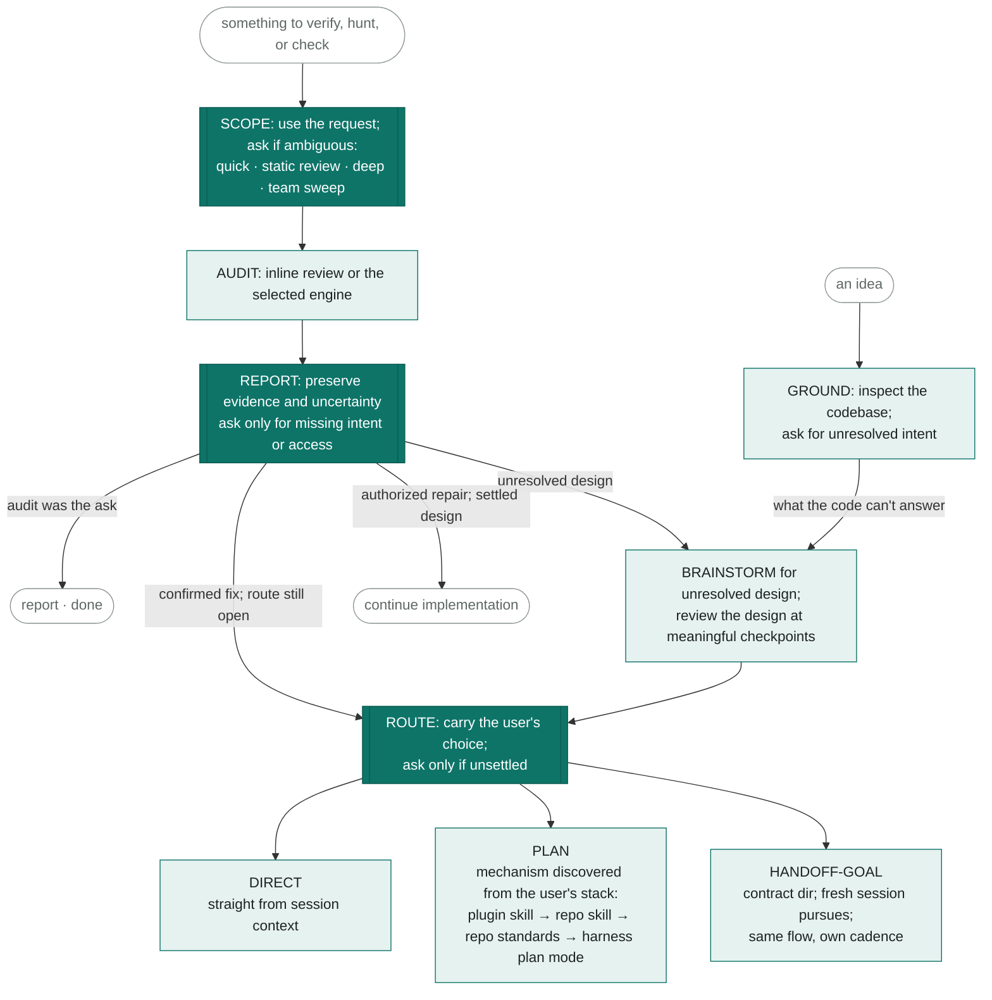
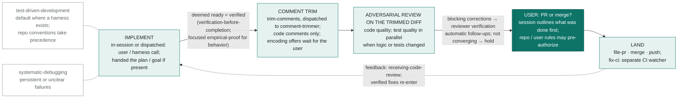

# The workbench flow

Workflow overview for **workbench**: entry, scoping, implementation, and
delivery. The [canonical orientation skill](../plugins/workbench/skills/using-workbench/SKILL.md)
and each owning skill define execution. Filled teal boxes mark decisions the
user supplies only when the request has left them open; existing choices and
authorization carry forward.

This Markdown diagram and its [HTML view](workbench-flow.html) summarize the
same flow. Update both when the workflow changes. Rationale lives in
[workbench-system](decisions/workbench-system.md).

## Entry & scoping: two optional doors

## Implementation: agency belongs to the user and the harness

During brainstorming, unresolved choices about module ownership, interfaces,
state, or dependencies load Workbench's `codebase-design` before the workset
is defined. The selected design and its constraints travel with the accepted
scope into implementation and review. Bounded work stays bounded; Toolkit is
not required.

## Read the owning contract

| Need | Source |
| --- | --- |
| Choose a skill for the task | [Skills handbook](skills/README.md) |
| Understand review timing, proof, and delivery authority | [using-workbench](../plugins/workbench/skills/using-workbench/SKILL.md) |
| Understand why this workflow exists | [Workbench decisions](decisions/workbench-system.md) |
| Understand repository layout and maintenance tools | [Repository map](../README.md#repository-map) |

Broad QA remains user-requested. Focused consumer proof supports behavioral
completion; a blocked check stays incomplete. Independent review runs when the
full agreed change is verified and ready for delivery. Each discipline owns its
blocking findings and follow-ups; unchanged evidence and completed stages stay
valid until a relevant change invalidates them. Explicit declines and
superseding repository rules retain precedence.
